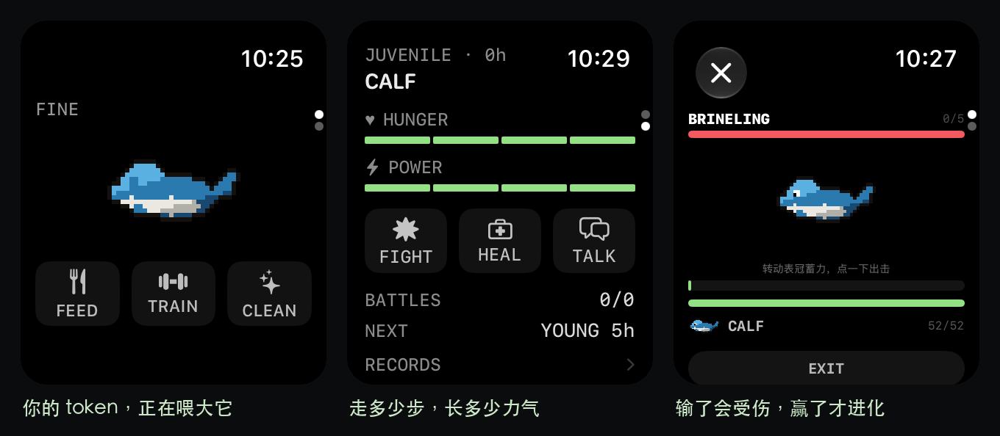
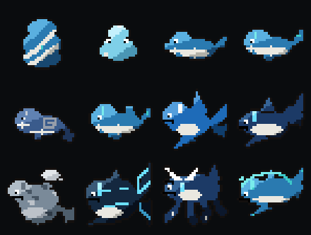

# Tidekin · 潮线

一只住在 Apple Watch 里的鲸。它不吃虚拟饲料，吃的是你真实的三样东西：**时间、步数、和你在表上跟它说话时消耗的 token**。

watchOS 独立 app，SwiftUI，无账号、无广告、无内购、无遥测。



---

## 它和普通电子宠物哪里不一样

普通电子宠物按现实时间掉心，漏看一次就记一笔；而 AI 账单里的 token 只是一串数字，和你没有关系。Tidekin 把这两件事接上：

| 驱动线 | 输入 | 影响 |
|---|---|---|
| 时间 | 真实清醒分钟 | 饥饿、力量衰减、便便、睡眠、失误窗口 |
| 健康 | HealthKit 当日步数 | 每 100 步折 1 分钟成长，另按比例补力量心 |
| Token | **只统计本 app 内对话**的用量 | 300 token 折 1 分钟成长；累计超 6000 转入「潜渊」线 |

三条线折算成「驱动分钟」，加权后推进进化。权重可单独关闭（`time=1` 其余为 0 时等于经典电子宠物）。

## 12 个原创形态

```
TIDESEED 潮种 → SPUME 沫沫 → CALF 鲸苗
   → CETAL 汐仔 / MAEL 涡仔            照顾得好不好
   → CURRENT 游潮 / BREACHER 跃潮
     / ABYSS 潜渊 / DRIFT 漂雾          三线分化
   → SIREN 歌潮 / KRAKEN 沧主 / KUN 鲲   完全体
```

成人分化看三样：失养 → 漂雾，训练 ≥32 → 跃潮，token ≥6000 → 潜渊，否则游潮。完全体门槛是 15 战 + 胜率 40%，潜渊与漂雾殊途同归，最后都沉成鲲。



## 关键设计决定

**watchOS 没有常驻计时器。** app 一挂起代码就停，所以世界用「时间快照 + 懒结算」：存 `lastResolvedAt`，下次进前台按 elapsed 批量补算。内核是纯函数 `resolve(world, now) -> (World, [Event])`，幂等，且不读系统时间（时间一律从参数传入），因此 5 天可以压成 1 秒做测试。

**历史必须可读。** 批量补算带来一个副作用：如果事件时间戳统一写成"结算那一刻"，日志会变成「孵化了/拉屎了/饿了」全挤在同一秒。所以事件带自己的发生时刻（`TimedEvent`），离线摘要才有意义。

**Liquid Glass 只在控制层。** 按 HIG，内容层用标准材质与亮度分层；屏上的强调绿只出现在三处——需求高亮、当前动作、计量条点亮段。

## 构建

需要 Xcode 26+（工程用 objectVersion 77 与 `PBXFileSystemSynchronizedRootGroup`）。

```bash
xcodebuild -scheme DigimonWatch -configuration Debug \
  -destination 'platform=watchOS Simulator,name=Apple Watch Series 12 (46mm)' \
  -derivedDataPath ./build CODE_SIGNING_ALLOWED=NO build

D=$(xcrun simctl list devices available | grep "Apple Watch Series 12 (46mm)" | grep -oE '[0-9A-F-]{36}')
xcrun simctl boot $D
xcrun simctl install $D build/Build/Products/Debug-watchsimulator/DigimonWatch.app
xcrun simctl launch $D com.serena.tidekin
```

调试开关（launch argument）：

| 参数 | 作用 |
|---|---|
| `-debugAwake YES` | 忽略睡眠时段 |
| `-debugPage N` | 直接打开第 N 页 |
| `-debugBattle YES` | 直接进战斗 |
| `-debugNewGame YES` | 重置为新蛋 |

## 内核测试（不需要手表）

```bash
./Tests/run.sh
```

31 项断言：孵化、阶段推进、失误、进化后计数清零、结算幂等、睡眠暂停计时、高频刷新不加速世界、三线驱动、成人四分支、完全体映射。编译 Core 纯值类型，不依赖 XCTest。

## 目录

```
DigimonWatch/
  Core/                    纯值类型，无 UI 依赖
    Tuning.swift           所有玩法数值（改玩法先改这里）
    World.swift            状态 + 角色表（换 IP 只改这张表）
    Simulator.swift        时间结算内核
    Evolution.swift        潮线进化判定
    Battle.swift           对手池与回合结算
    Schedule.swift         下一个关键事件（供通知/表盘用）
    Notifier.swift         本地通知，单条滚动续排
    Persistence.swift      JSON → App Group 容器
    Drivers/               HealthKit 步数、对话客户端、Keychain
  UI/
    RootView.swift         两页 + 记录 sheet
    LCDView.swift          32×32 精灵、眨眼、孵化脉动
    BattleView.swift       Crown 蓄力战斗
    ChatView.swift         对话 + 举报入口
    ConsentView.swift      对话前告知
    StatusScreens.swift    GONE 死亡屏、离线摘要
    Theme.swift            色阶 + 版式栅格
    SpriteStore.swift      资源加载、32/16 回落、居中
  Resources/Sprites/       12 组 × (32.png, 32_b.png)
  PrivacyInfo.xcprivacy
DigimonWidget/             表盘小组件（三种槽位）
Art/                       像素画生成脚本（可重跑）
Tests/                     内核断言
docs/specs/                IP 与玩法规格
```

## 美术

全部自绘。`Art/build_whale_a.py` / `build_whale_b.py` 是可重复运行的生成脚本（Pillow，无外部素材），跑完用 `Art/polish32.py` 清噪点。

设计约束：32×32、1px 暗轮廓、左上 45° 光源、每种材质 2–3 级色阶、不用抗锯齿、不用抖动。贯穿全弧线的识别元素是**白腹 + 额头青色光标纹 + 蓝白配色**。

```bash
python3 Art/build_whale_a.py && python3 Art/build_whale_b.py && python3 Art/polish32.py
```

## 已知限制

- **真机未验证**：Crown 翻页手感、表盘组件注册、Always-On 下的脉动，只在模拟器跑过
- **对话需要自填 API Key**：存在 Keychain，不上传；没填时 TALK 会提示
- **token 只统计本 app 内对话**：读不到你在别处的用量，产品描述里写明了这一点
- **输出过滤是最低限度的关键词拦截**，不是内容审核系统

## 设计文档

- [`docs/specs/ip-whale-line.md`](docs/specs/ip-whale-line.md) —— 12 形态的命名、视觉处方、进化映射
- [`docs/store-copy.md`](docs/store-copy.md) —— 商店文案、关键词、分级建议

## 许可

代码 MIT。像素美术与角色设定同样以 MIT 发布。

角色、阶段、进化条件、对手池均为原创；不含任何 AI 厂商商标或第三方角色设计。原型只取思想层：鲸 + 蓝白 + AI 提示符语汇 + 萌系比例。
